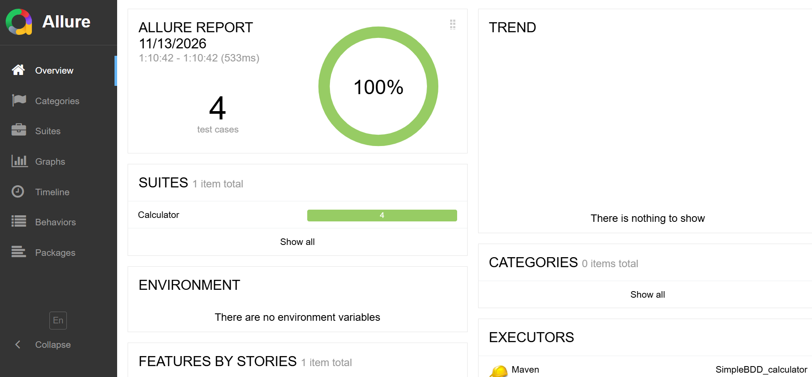

# Simple BDD Calculator


A small Cucumber BDD project in Java, built to practise BDD basics: feature files, step definitions, hooks, tags, data tables, logging and reporting.

## Tech stack

Java 21, Maven, Cucumber 7, TestNG, Log4j2, Extent Reports, Allure

## What it shows

- Feature file with a Scenario Outline and multiple Examples tables
- Tags to run groups of scenarios
- Step definitions, a TestNG runner class, and settings read from a properties file
- Hooks (`@Before` / `@After`) that run around every scenario
- Logging with Log4j2
- Three reports: Cucumber HTML, Extent and Allure

## Project layout

```
src/test/java
  calculator/        the class under test
  hooks/             Hooks: @Before / @After setup and teardown for each scenario
  stepdefinitions/   Given / When / Then steps
  runners/           TestRunner
  utils/             helpers (config reader)
src/test/resources
  features/          .feature files
  config.properties
  log4j2.xml
  extent.properties
  allure.properties
```

## How to run

```
mvn clean test
```

Run only tagged scenarios:

```
mvn clean test -Dcucumber.filter.tags="@smoke"
```

Use the tag names that exist in your feature file.

## Reports

| Report | Location |
|---|---|
| Cucumber HTML | `target/cucumber-reports.html` |
| Extent | `target/ExtentReports/` |
| Allure results | `target/allure-results` |
| Logs | `logs/` |

To open the Allure report after a test run:

```
mvn allure:serve
```

### Allure


All generated folders are ignored by Git.
